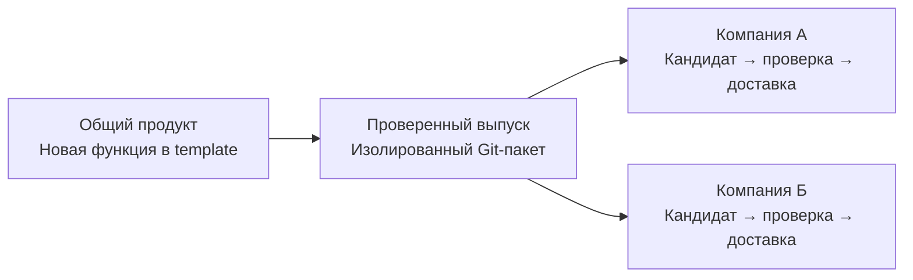

# Рабочая система компании

**Версия 1.4.0** · файловая память · агенты · общий Git

Переносимый шаблон для команды: задачи, правила, источники и результаты лежат в понятных местах. Агент находит нужный метод по карте, выполняет разрешённую работу, проверяет её и сохраняет общую версию.

[Первая компания](template/docs/first-company.md) · [Наблюдения после доставки](template/docs/observations.md) · [Схемы для команды](template/docs/company-system-guide.html) · [Карта компании](template/company/README.md) · [Обновление и восстановление](template/standards/template-update.md)

У каждой компании сохраняются свои данные, настройки и местные решения. Новые функции передаются через проверенный выпуск; применение выполняется отдельно для выбранной компании. Рабочие планы, отчёты и свидетельства разработки хранятся отдельно от публичного репозитория и пакета компании.

## Версии

| Выпуск | Что изменилось |
| --- | --- |
| **1.4.0** | Защита execute/observe от устаревшего намерения; независимые доставка, применение и эффект в сводке; единый учебный проход установки, обновления и восстановления; документы разработки вынесены из текущего публичного дерева |
| 1.3.1 | Company Organization: read-only сверка путей, карт, ссылок и закреплённых потребителей; безопасный перенос через exact pre/postimage без автоперемещений из hooks |
| 1.3.0 | Настройка окружения без Python; общий runtime для Windows/WSL2/macOS/Linux; точные bytes, переносимое восстановление и тонкие адаптеры |
| 1.2.0 | Пакетная проверка экспортируемой Git-истории; точные зависимости задач; шесть локальных хуков и переносимые настройки двух сред |
| 1.1.5 | Проверка источников аналитики и сохранённой истории; окончательная отмена; изоляция Git; восстановление кэша и прерванного обновления |
| 1.1.4 | Переносимый пакет обновления одной командой; маршрут новой функции из продукта в компанию; проверка передачи нового навыка и программы |
| 1.1.3 | Читаемость и отступы визуального руководства, системный шрифт |
| 1.1.2 | Руководство со схемами; согласованные рецепты навыков без лишних повторов |
| 1.1.1 | Соразмерные проверки; доставка законченной задачи; повторные синки уточнений исключены |
| 1.1.0 | Безопасная проверка общей версии в начале самостоятельной задачи |
| 1.0.0 | Полный локальный комплект: память и карты, бизнес-блоки, стандарты и навыки, процессы, проверки, API/MCP, Git, граф и развитие компаний |

Хуки по умолчанию выключены. Общий CLI и оба протокола проверяются локально; native trust/events и live аккаунты требуют собственного подтверждения.

Выпуск1.3.0 проверен на Ubuntu24.04 x64, macOS14 ARM64 и WindowsServer2022 x64. Новый1.4.0 проверяется локально в WSL2; прежняя матрица не является проверкой нового кандидата на всех ОС. Точные границы — в профилях среды.

Первый запуск на новой машине: [подготовка среды](template/adapters/README.md). Native skills/hooks и доступ к аккаунтам проверяются отдельно от runtime ОС.

Источник текущего номера — [release.yaml](template/release.yaml). Границы проверенных сред и native/live указаны в [профилях](template/adapters/README.md).

В1.4.0 вызовы `execute` требуют `--expected-revision`, а `observe` также `--expected-result-sha256`. Старые task/result/snapshot schema1 читаются без миграции. При конфликте версий агент перечитывает задачу и пересматривает намерение; автоматическая подстановка свежих токенов запрещена.

## Порядок чтения

1. [Комплект компании](template/README.md) → карта → нужная операция.
2. [Подготовка среды](template/adapters/README.md) и [общий runtime](template/standards/runtime.md).
3. [Обновление, резервная копия и восстановление](template/standards/template-update.md).

Канонический комплект компании — **template/**. Для установки передаётся проверенная изолированная split-история этого каталога; clone всего product repository в компанию не используется. Код разработки и проверки находятся в этом публичном репозитории; рабочие документы развития, планы, отчёты и служебные материалы — во внешней приватной зоне. Указатель для сопровождающего описан в [AGENTS.md](AGENTS.md). Перенос документов из текущего дерева не удаляет их ранее опубликованные версии из Git history.
